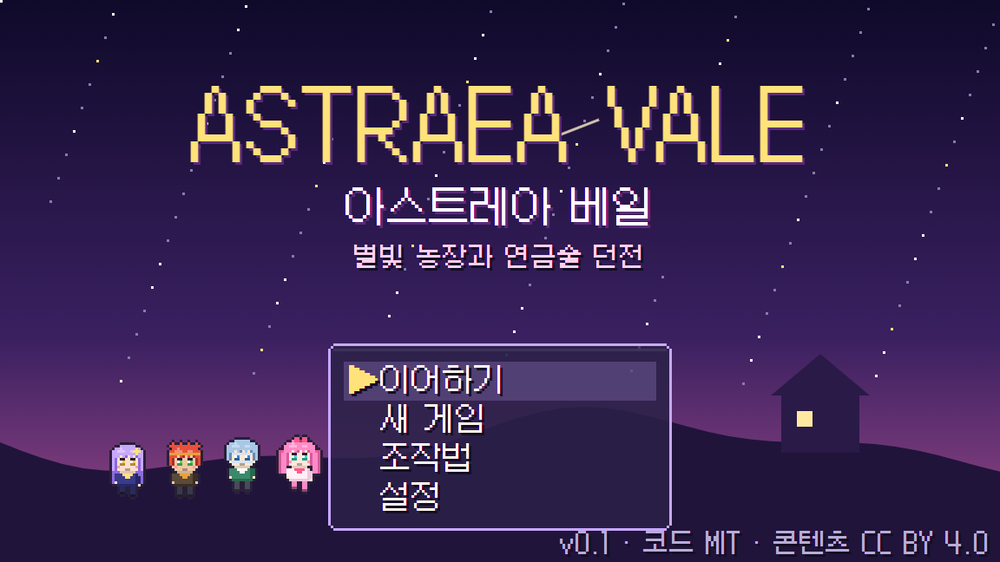
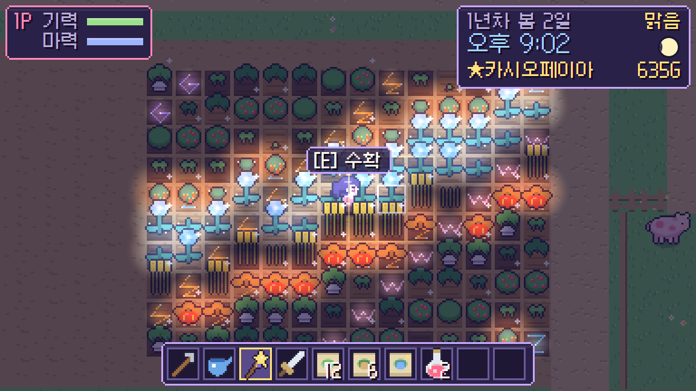
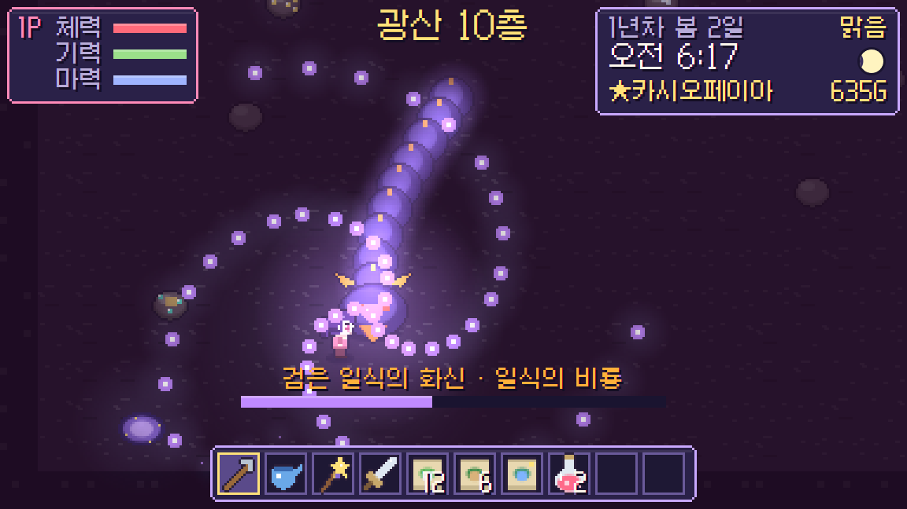
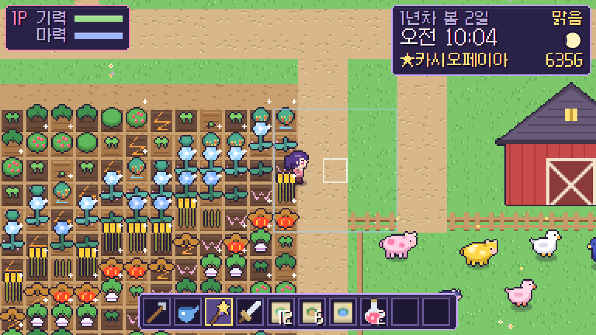
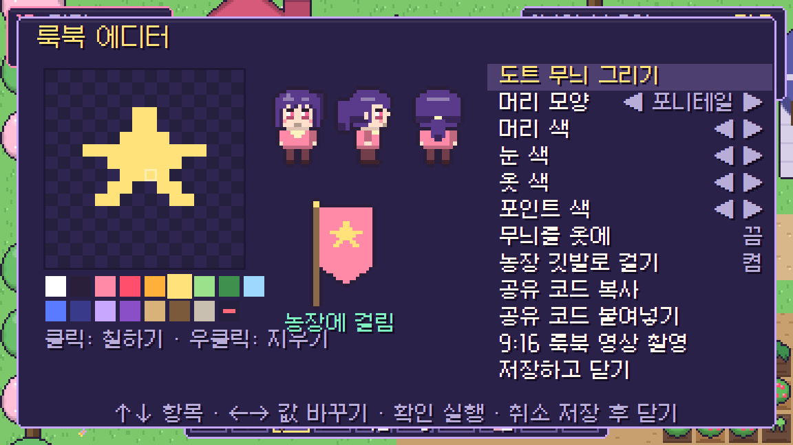
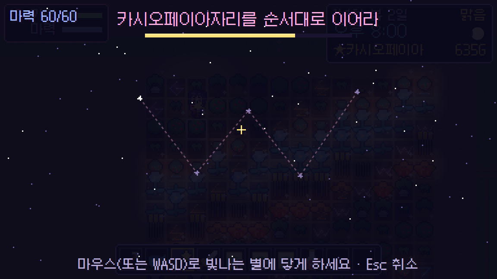
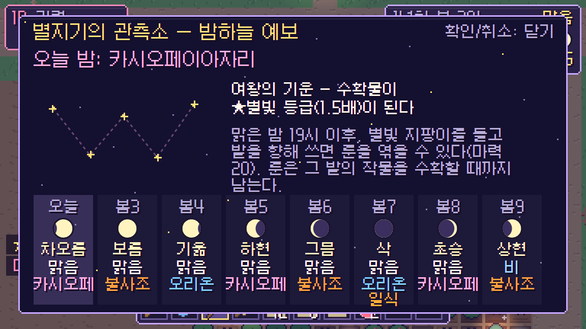
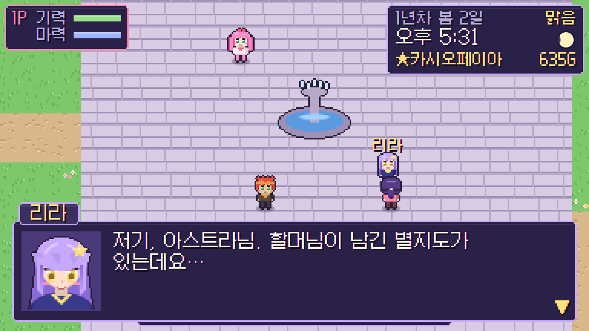
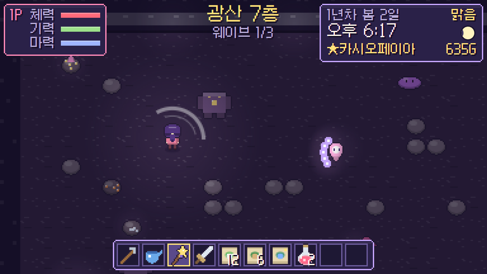

<div align="center">



# Astraea Vale · 아스트레아 베일

**별자리 마법 농경 × 콤보 슬라이싱 던전 × 로컬 협동** — 90년대 아니메풍 픽셀 라이프 RPG

<a href="https://jeiel85.github.io/astraea-vale/"></a>


</div>

십 년 전 '검은 일식'이 하늘을 가른 뒤, 별빛이 내려앉던 골짜기 아스트레아 베일은 메마르고 광산 깊은 곳에선 괴물이 깨어났습니다. 할머니가 남긴 **별빛 지팡이**와 낡은 천문 농장을 물려받아, 밤하늘의 별자리를 밭에 엮고 광산의 괴물을 베어 골짜기를 되살리세요.

설치 없이 브라우저에서 바로 플레이할 수 있습니다. 그림·음악·효과음은 이미지나 오디오 파일 없이 **모두 코드로 그리고 합성**합니다.

---

## 네 가지 축

<table>
<tr>
<td width="50%"><br><b>별자리 위상 천문 농업</b><br><sub>맑은 밤, 그날 밤 하늘에 뜬 별자리를 지팡이로 밭 위에 엮습니다. 오리온은 성장 가속, 카시오페이아는 ★별빛 등급, 불사조는 수확량 +1과 계절 보호, 개기월식 밤의 '일식의 그림자'는 ☀일식 등급(3배). 보름달에만 피는 <b>달빛 장미</b>, 일식 동안 거두면 3배가 되는 <b>태양 밀</b>까지.</sub></td>
<td width="50%"><br><b>콤보 슬라이싱 연금술 던전</b><br><sub>3단 콤보, 대시 무적, 대시 직후 돌진 베기, 마력을 쓰는 별빛 베기. 적의 탄은 칼로 베어 없앨 수 있고 적중하면 마력이 찹니다. 모든 공격은 붉은 예고 표시가 먼저 뜹니다. 10층 구성, 5층 정동석 여왕과 10층 일식의 비룡.</sub></td>
</tr>
<tr>
<td><br><b>정수가 도는 순환 경제</b><br><sub>몬스터 정수로 만든 <b>정수 비료</b>를 목장에 뿌리면 교배 대기가 80% 줄고 돌연변이가 잦아져 파스텔 핑크 · 별무늬 네이비 · 골든 글로우 변종이 태어납니다. 농장 수확물은 다시 던전용 물약(무적, 화염 폭풍)이 됩니다.</sub></td>
<td><br><b>도트 룩북 에디터 & 9:16 영상</b><br><sub>16×16 도트 무늬를 그려 옷과 농장 깃발에 입히고, 공유 코드(AV1…)로 친구와 주고받습니다. 버튼 하나로 90년대 아니메 오프닝풍 VHS 필터를 입힌 <b>세로형 룩북 영상</b>(mp4/webm)을 만들어 내려받습니다.</sub></td>
</tr>
</table>

**로컬 협동 1~4인** — 플레이 중 게임패드 Start/A, 또는 키보드 Enter를 누르면 바로 참가합니다(1P가 키보드면 2P는 방향키 쪽). 가방과 골드를 함께 쓰고, 광산에서 쓰러진 동료는 옆에서 상호작용 키를 눌러 일으킵니다.

## 화면

<table>
<tr>
<td width="50%"><br><sub>별자리 엮기 — 빛나는 별을 순서대로 이으면 룬이 밭에 내려앉습니다.</sub></td>
<td width="50%"><br><sub>관측소 — 8일치 달 위상 · 날씨 · 별자리 · 일식/월식 · 축제 예보.</sub></td>
</tr>
<tr>
<td><br><sub>마을 — 별지기 리라, 대장장이 브람, 잡화점 솔, 축제 담당 노바. 시간·날씨·달·친밀도에 따라 대사가 바뀌고 하트 이벤트가 열립니다.</sub></td>
<td><br><sub>광산 — 웨이브를 정화하면 계단이 열리고, 광석 바위를 베어 구리·월은·별 결정·고대 유물을 캡니다.</sub></td>
</tr>
</table>

## 조작

| | 키보드·마우스 (1P) | 키보드 방향키 (2P) | 게임패드 |
| :-- | :-- | :-- | :-- |
| 이동 | WASD | ← ↑ → ↓ | 왼스틱 / 십자키 |
| 도구 사용 · 공격 | J / 왼쪽 클릭 | . | X |
| 상호작용(대화·수확·쓰다듬기) | E | Enter | A |
| 대시 | Space / K | / | B |
| 별빛 베기(광산) | L / 오른쪽 클릭 | ; | Y |
| 물약·음식 | Q | ' | RT |
| 핫바 | 1~0 · 휠 · Z/C | [ ] | LB / RB |
| 가방 · 메뉴 | Tab · Esc | \ | Back · Start |

마우스를 움직이면 도구를 쓸 칸과 공격 방향을 마우스로 정합니다. 게임패드는 오른스틱으로 조준합니다.

## 하루의 흐름

1. **아침** — 괭이로 밭을 갈고 씨앗을 심어 물을 줍니다. 지팡이를 낮에 쓰면 마력 15로 5×5 칸에 비를 내립니다. 가축을 쓰다듬고 우유·알을 거둡니다.
2. **낮** — 오른쪽 길로 마을에 가서 씨앗을 사고, 주민과 이야기하고 선물합니다. 남동쪽 동굴은 광산입니다.
3. **밤(19시~)** — 맑은 밤이면 지팡이로 그날 밤의 별자리 룬을 엮습니다(마력 20). 보름달 밤엔 달빛 장미가 핍니다.
4. **잠자리** — 집에서 잠들면 출하함이 정산되고 하루가 저장됩니다. 새벽 2시를 넘기거나 광산에서 모두 쓰러지면 골드 10%(최대 300)를 잃고 집에서 깨어납니다.

계절은 28일, 달은 8일 주기로 돌고, 일식·개기월식·별빛 수확제(계절 19일 저녁)는 관측소에서 미리 볼 수 있습니다. 목표 10개 중 둘을 이룰 때마다 **마을 등급**이 올라 광장이 꽃상자 → 등불 → 깃발 → 별가루 분수 → 별빛 아치로 꾸며집니다.

<details>
<summary><b>작물 · 연금술 · 가축 상세</b></summary>

**기초 작물 10종** — 순무, 감자, 당근, 딸기, 토마토, 옥수수, 블루베리, 가지, 호박, 양배추(계절별, 일부 재수확).

**천문 작물 6종** (사계절)

| 작물 | 조건 | 특징 |
| :-- | :-- | :-- |
| 별고추 | 오리온 룬 위에서만 싹 | 재수확, 질풍 엘릭서 재료 |
| 별종꽃 | 카시오페이아 룬 | 별의 비약 재료, 리라가 좋아함 |
| 불사조 열매 | 불사조 룬 | 화염 폭풍 재료 |
| 달빛 장미 | 보름달 밤에만 개화 | 별빛 방패(4초 무적) 재료 |
| 태양 밀 | 일식(11~15시)에 수확하면 ☀3배 | 일식의 영약 재료 |
| 그림자 연꽃 | 개기월식 밤의 룬 위에서만 | 5층 보스 드롭 · 마을 등급 3에 상점 입고 |

**연금술 가마솥** — 회복 토닉, 정수 비료, 질풍 엘릭서, 별빛 방패, 불사조 화염폭풍, 별의 비약, 일식의 영약.

**가축** — 소·오리. 하루 한 번 쓰다듬으면 애정이 오르고(70 이상이면 ★별빛 생산물), 애정 40 이상인 어른끼리 교배합니다. 새끼는 부모 변종을 물려받고 일정 확률로 한 단계 위로 돌연변이합니다.

</details>

## 설계서와의 대응

[설계서](docs/2026-11-05_인디게임_분석_및_설계서_AstraeaVale.md)의 네 가지 +α 시스템을 브라우저에서 바로 플레이할 수 있는 범위로 구현했습니다.

| 설계서 | 이 저장소 |
| :-- | :-- |
| Godot/Unity, Steam·Switch | TypeScript + Canvas 2D 웹 빌드, GitHub Pages 라이브 데모 ([결정 기록](DECISIONS.md)) |
| 천문 별자리 농업 | 구현 — 달 8위상, 일식·월식, 별자리 4종 룬, 천문 작물 6종 |
| 콤보 슬라이싱 던전 + 정수 비료 순환 | 구현 — 10층, 보스 2종, 정수 비료 → 교배 80% 단축·돌연변이 |
| 2~4인 드롭인 협동 (Steam P2P) | **로컬** 1~4인 드롭인. 온라인 P2P는 아직 없음 |
| 룩북 에디터 + 스팀 창작마당 | 도트 에디터 + **공유 코드** + 9:16 영상 내보내기. 창작마당 연동은 없음 |
| FMOD 오디오 | Web Audio 실시간 합성(효과음 39종, 배경음 8곡) |

## 개발

```bash
npm install
```

```bash
npm run dev
```

```bash
npm test
```

```bash
npm run build
```

- `src/sim/` — 달력·천문, 농사, 가축 교배, 연금술, 주민, 저장 같은 **순수 로직**. `tests/`의 Vitest가 검증합니다.
- `src/world/` — 맵, 플레이어·몬스터, 광산 생성과 보스 AI, 조명.
- `src/art/` — 모든 도트 그래픽을 코드로 그리는 곳(벡터를 그린 뒤 알파를 잘라 선명한 픽셀로 만듦).
- `src/ui/` — HUD, 대화·상점·연금술·관측소·룩북 등 화면.
- `src/engine/` — 캔버스 스케일링, 입력(키보드·마우스·게임패드 4대), 오디오 합성.

저장은 브라우저 `localStorage`에 하며, 잠자리에 들 때만 저장됩니다.

## 라이선스

- **코드**: [MIT](LICENSE)
- **콘텐츠**(캐릭터 이름·대사·이야기·설정 문장, `docs/` 의 설계서와 스크린샷): [CC BY 4.0](LICENSE-CONTENT.md). 그래픽과 소리를 만들어 내는 코드는 MIT입니다.
- **글꼴**: [Galmuri](https://github.com/quiple/galmuri) © Lee Minseo — [SIL Open Font License 1.1](public/licenses/galmuri-ofl.md)

이 게임은 장르의 관례(농장 생활 시뮬레이션, 핵앤슬래시 던전)를 바탕으로 한 오리지널 작품이며, 등장인물·세계관·그래픽·음악은 모두 새로 만든 것입니다.
